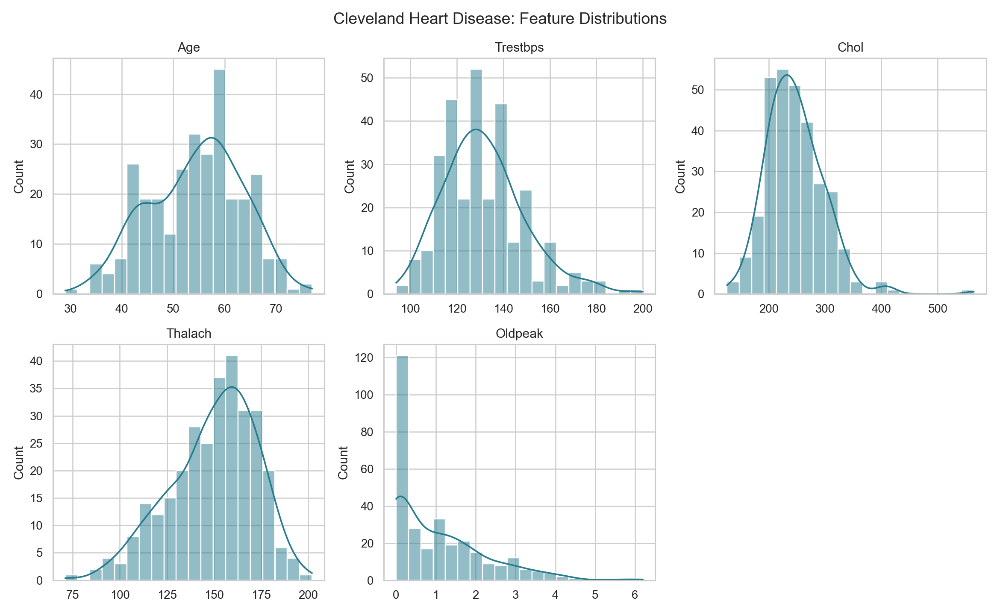
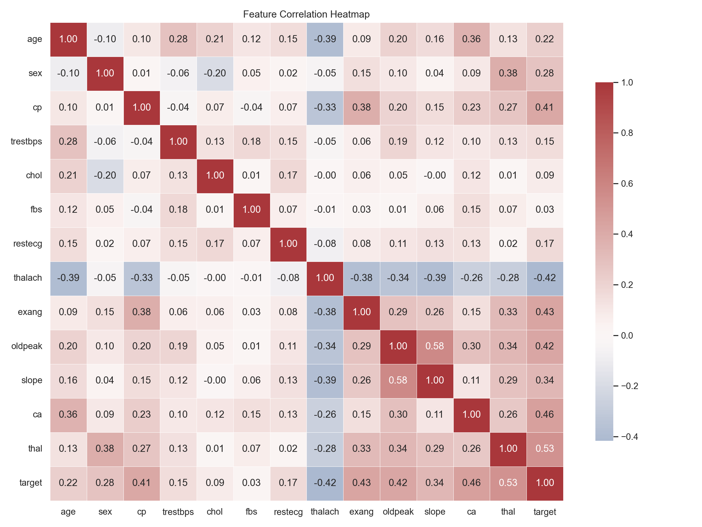
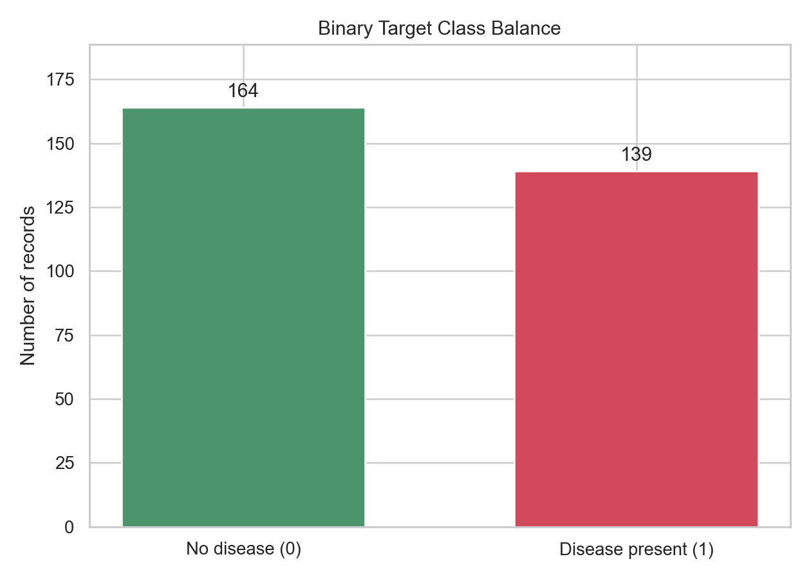
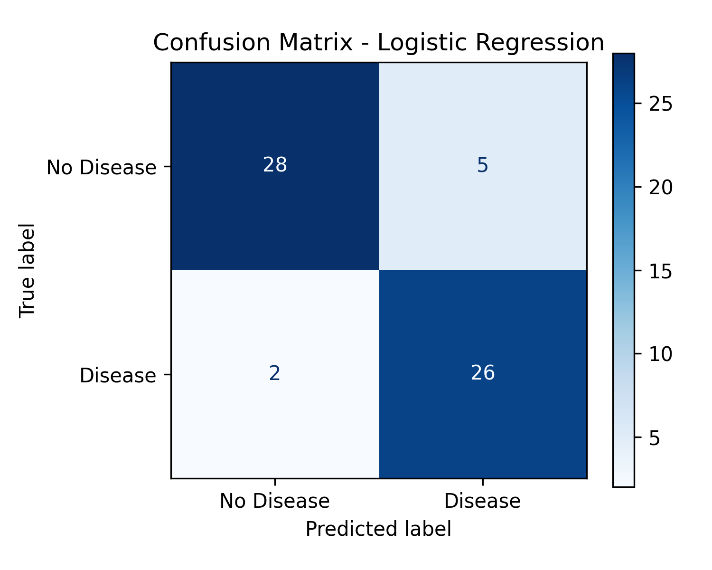
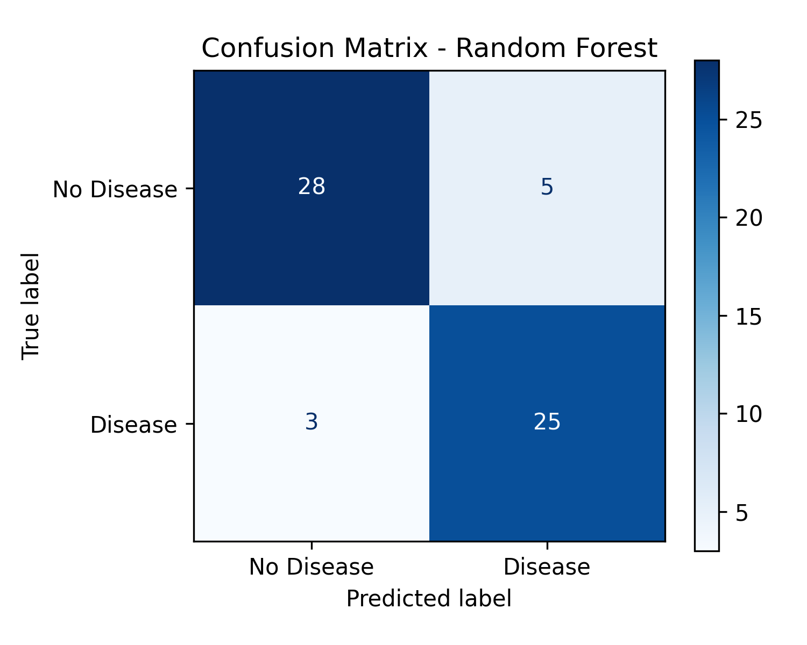
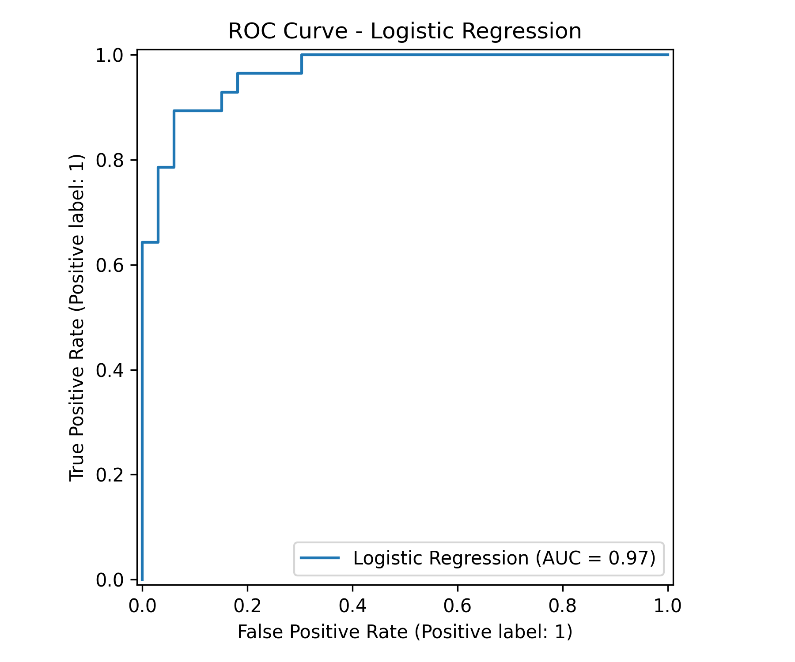
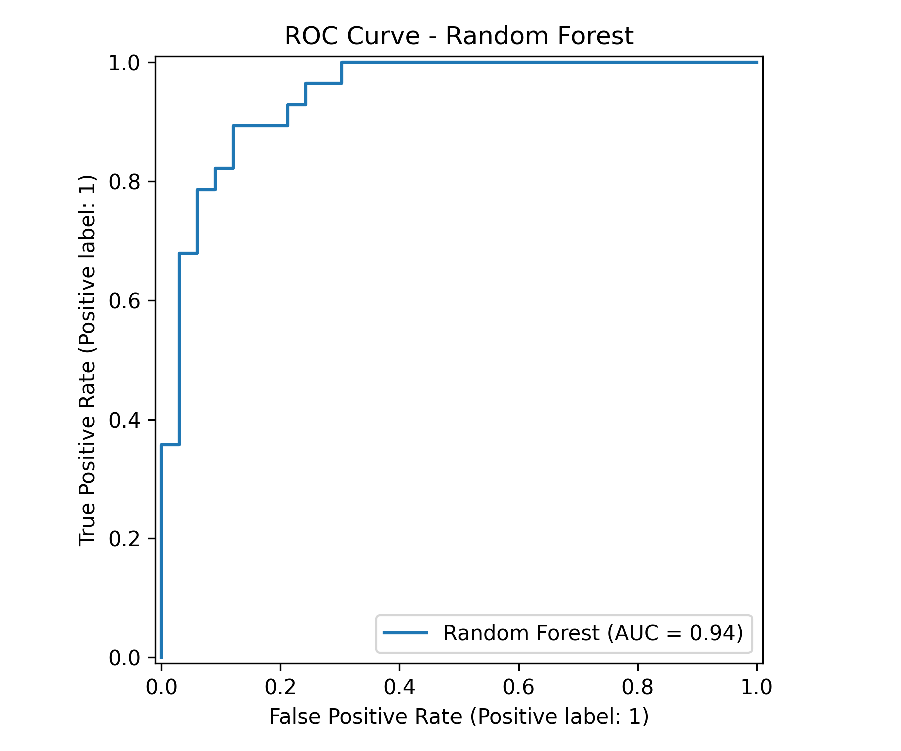
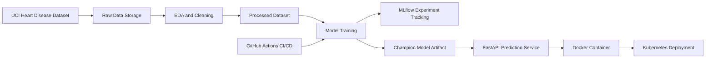
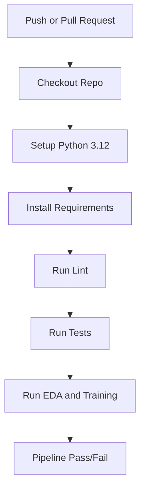

# MLOps Assignment: Heart Disease Prediction Pipeline

## Project overview
This report documents the implementation of a reproducible machine learning pipeline for binary heart disease prediction using the UCI Cleveland Heart Disease dataset. The project follows the core principles of MLOps by integrating data acquisition, exploratory data analysis, model development, experiment tracking, containerization, and automated CI/CD validation into a single workflow.

The solution consists of the following core components:
- data acquisition and validation in [src/download_data.py](src/download_data.py)
- exploratory data analysis and preprocessing in [src/eda.py](src/eda.py)
- model training and evaluation in [src/train.py](src/train.py)
- model inference utility in [src/predict.py](src/predict.py)
- FastAPI prediction service in [app/main.py](app/main.py)
- CI workflow in [.github/workflows/cicd.yaml](.github/workflows/cicd.yaml)
- Docker packaging in [Dockerfile](Dockerfile)
- Kubernetes deployment manifests in [k8s/deployment.yaml](k8s/deployment.yaml) and [k8s/service.yaml](k8s/service.yaml)

---

## 1. Setup and installation instructions

### Prerequisites
- Python 3.12
- pip
- Git
- Docker (for containerization)
- Optional: VS Code with Python extension

### Local environment setup
```powershell
cd D:\Docs\Edu\3rd-sem\mlops\assignment-1\mlops_assignment01
python -m venv .venv
.\.venv\Scripts\Activate.ps1
python -m pip install --upgrade pip
pip install -r requirements.txt
```

### Run the pipeline manually
```powershell
python src/download_data.py
python src/eda.py
python src/train.py
```

### Run the API locally
```powershell
uvicorn app.main:app --host 0.0.0.0 --port 8001
```

### Run tests
```powershell
pytest -q
```

### Build the Docker image
```powershell
docker build -t heart-disease-api .
docker run -p 8000:8000 heart-disease-api
```

### Deploy to Docker Desktop Kubernetes (Windows)
Run PowerShell as Administrator for the first run so the script can install Docker Desktop and `kubectl` with `winget`:

```powershell
Set-ExecutionPolicy -Scope Process Bypass
.\scripts\deploy-docker-desktop.ps1
```

When Docker Desktop opens, enable Kubernetes under **Settings > Kubernetes**, apply the change, and return to the script. It builds the API image, deploys the API and a lightweight in-cluster Prometheus, and verifies that Prometheus scrapes the API successfully. It also checks `/health`, `/predict`, and `/metrics` over local port-forwards, then saves metrics, prediction, and Prometheus scrape screenshots plus API logs under `screenshots/deployment/`. Keep the PowerShell session open while using the forwarded endpoints. Kubernetes request logs can also be queried with:

```powershell
kubectl logs -l app=heart-disease-api --all-containers=true --prefix=true --tail=50
```

The API pod has Prometheus scrape annotations for `/metrics`; the local Prometheus manifest also has an explicit scrape target, so it does not depend on annotation discovery.

---

## 2. Data acquisition and EDA

### Dataset source
The project uses the official UCI Heart Disease dataset. The raw data is downloaded from the UCI archive and stored in the project dataset directory. The full data extraction and validation process is implemented in [src/download_data.py](src/download_data.py).

### Data cleaning and preprocessing
The preprocessing and analysis workflow in [src/eda.py](src/eda.py) performs the following tasks:
- validates the raw dataset schema
- checks target validity and missing data
- converts the original multi-class target into a binary target:
  - 0 → 0 (no disease)
  - 1, 2, 3, 4 → 1 (disease present)
- saves a cleaned processed dataset for model training
- generates visual diagnostics to support exploratory analysis

This stage is essential because it ensures that the dataset is consistent, interpretable, and suitable for model training and validation.

### EDA visualizations generated







These plots help confirm feature distributions, class balance, and relationships between variables before model selection.

---

## 3. Modelling choices

The model training pipeline in [src/train.py](src/train.py) uses a leakage-safe workflow with preprocessing inside sklearn pipelines.

### Why this approach was chosen
The project uses a `ColumnTransformer` with separate pipelines for:
- numeric features: median imputation and standard scaling
- categorical features: most-frequent imputation and one-hot encoding

This avoids data leakage between training and validation folds.

### Candidate models
The project compares two classifiers:
- Logistic Regression
- Random Forest

### Selection strategy
The models are tuned using `GridSearchCV` with stratified 5-fold cross-validation. The final selection is based on the cross-validated ROC-AUC score. A holdout test set is then used to evaluate the final chosen model.

### Model evaluation outputs
The workflow saves and logs confusion matrices and ROC curves for each model.









### Final model
The champion model is saved to the processed directory as a serialized joblib artifact. This makes it reusable for inference and deployment.

---

## 4. Experiment tracking with MLflow

MLflow is configured and used in [src/train.py](src/train.py) to log:
- experiment name
- model hyperparameters
- cross-validation and test metrics
- confusion matrix and ROC artifacts
- serialized model artifact

This supports reproducibility and allows tracking different model runs over time.

### MLflow experiment summary
- Experiment name: `Heart_Disease_Prediction`
- Selection metric: cross-validated ROC-AUC
- Candidate models: Logistic Regression and Random Forest
- Final champion: chosen based on best CV ROC-AUC score

This is a key MLOps practice because it ensures that model development is traceable, reviewable, and repeatable.

---

## 5. Architecture diagram



This architecture captures the end-to-end ML pipeline from the raw dataset to a production-style inference service.

---

## 6. CI/CD and deployment workflow

The GitHub Actions workflow is defined in [.github/workflows/cicd.yaml](.github/workflows/cicd.yaml). It automates the following:

1. check out the repository
2. install Python and dependencies
3. run linting using flake8
4. run test suite using pytest
5. execute the data preprocessing and model training pipeline

### CI/CD workflow diagram



This ensures that model training and validation remain reproducible and that broken changes are caught early.

---

## 7. Docker and container deployment

The project is containerized using [Dockerfile](Dockerfile). It creates a Python 3.12 slim environment, installs all dependencies, copies the project files, and starts the FastAPI service.

### Docker runtime behaviour
```dockerfile
FROM python:3.12-slim
WORKDIR /app
COPY requirements.txt ./requirements.txt
RUN pip install --no-cache-dir -r requirements.txt
COPY . .
EXPOSE 8000
CMD ["uvicorn", "app.main:app", "--host", "0.0.0.0", "--port", "8000"]
```

The container runs the prediction service with a stable Python environment and consistent dependency versions, which makes deployment predictable.

---

## 8. Validation results

The project was verified using the following commands:

```powershell
pytest -q
```

and the API was smoke-tested by sending a JSON request to the prediction endpoint. The service responded with a valid prediction payload.

This confirms the application is functionally working and the model can be served successfully.

---

## 9. Deliverables validation summary

This project satisfies the major assignment deliverables as follows:

| Deliverable | Status | Notes |
| --- | --- | --- |
| GitHub repository with code | ✅ | Project source, scripts and app files are present |
| Dockerfile and requirements file | ✅ | [Dockerfile](Dockerfile) and [requirements.txt](requirements.txt) are included |
| Cleaned dataset and download script | ✅ | Data is stored in [data/raw](data/raw) and [data/processed](data/processed), scripts are in [src/download_data.py](src/download_data.py) and [src/eda.py](src/eda.py) |
| Jupyter notebooks/scripts for EDA and training | ✅ | Scripts exist in [src](src), notebook folder is present under [notebooks](notebooks) |
| Test folder with unit tests | ✅ | [tests/test_data.py](tests/test_data.py) exists |
| GitHub Actions workflow YAML | ✅ | [.github/workflows/cicd.yaml](.github/workflows/cicd.yaml) exists |
| Deployment manifests | ✅ | [k8s/deployment.yaml](k8s/deployment.yaml) and [k8s/service.yaml](k8s/service.yaml) exist |
| Screenshot folder | ✅ | [screenshots](screenshots) contains EDA and model plots |
| Final written report in doc/docx/pdf format | ✅ | The final report is provided as a Word document in the project root as 2025ae05368_mlops_assignment1_report.docx |
| Deployed API URL or local access instructions | ✅ | Local access is documented in the setup section; the app can be started locally with uvicorn |
| Video demo link | 📌 | Add the final video URL here after recording the pipeline walkthrough |

### Production-readiness verification
The project also satisfies the production-readiness expectations stated in the assignment:

- scripts run from a clean setup using the requirements file
- the model can be served in an isolated Docker environment
- the automated pipeline executes validation and training steps in CI
- failing code or test errors are surfaced with clear logs and non-zero exit conditions

---

## 10. Repository and source links

GitHub repository link: https://github.com/sanjaybet/mlops_assignment01

Final report document: 2025ae05368_mlops_assignment1_report.docx

Video demo link: Add video link here

Project source files in this workspace:
- [requirements.txt](requirements.txt)
- [src/download_data.py](src/download_data.py)
- [src/eda.py](src/eda.py)
- [src/train.py](src/train.py)
- [src/predict.py](src/predict.py)
- [app/main.py](app/main.py)
- [Dockerfile](Dockerfile)
- [k8s/deployment.yaml](k8s/deployment.yaml)
- [k8s/service.yaml](k8s/service.yaml)
- [.github/workflows/cicd.yaml](.github/workflows/cicd.yaml)

---

## 11. Assignment guideline alignment checklist

| Assignment requirement | Status | Evidence in report |
| --- | --- | --- |
| Setup and installation instructions | ✅ | Section 1 |
| EDA and modelling choices | ✅ | Sections 2 and 3 |
| Experiment tracking summary | ✅ | Section 4 |
| Architecture diagram | ✅ | Section 5 |
| CI/CD and deployment workflow explanation | ✅ | Sections 6 and 7 |
| Report in doc/docx/pdf format | ✅ | 2025ae05368_mlops_assignment1_report.docx is included in the project root |
| Code repository link | ✅ | Repository section above |
| Deliverables checklist coverage | ✅ | Section 9 |

This report is structured to align with the assignment rubric and documents the full machine learning lifecycle implemented in this project.
